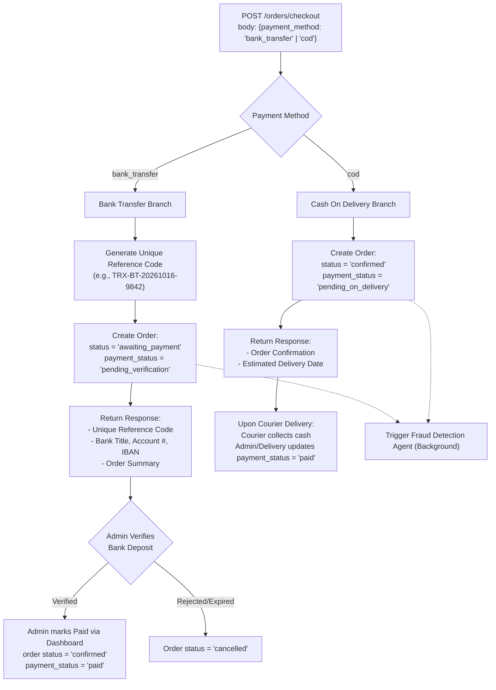
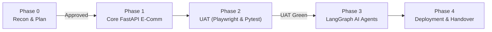

# 📋 Project Migration & Implementation Plan: Django-Trendora to FastAPI + LangGraph AI

**Target System:** High-Performance Async FastAPI E-Commerce Platform with Custom Payments, Modern Storefront (Tailwind + HTMX), Custom Admin Dashboard, and Multi-Agent AI Core (LangGraph).  
**Reference Repository:** `msncoder/Django-Trendora` (cloned into `/reference/`).  
**Status:** Phase 0 Reconnaissance & Planning Complete. **Awaiting User Confirmation Before Phase 1 Execution.**

---

## 1. Executive Summary & Reconnaissance Findings

### 1.1 Reference Codebase Overview
The reference repository `Django-Trendora` is a monolithic Django 5.2 application providing basic retail e-commerce features:
- **Framework:** Django with Django ORM, Django Templates (DTL), session-based cart, and `django.contrib.admin` customized with `jazzmin`.
- **Data Models:** Instead of a unified relational catalog, the project fragmented items across 4 distinct models (`Jewellerie`, `Clothe`, `Fragrance`, `Cosmetic`), with a rudimentary `CartItem` model (linked only to `Jewellerie`) while the active shopping cart was stored directly in Django sessions. Customer addresses were denormalized as flat text fields on the `Order` model.
- **Authentication:** Custom `CustomUser` model inheriting from `AbstractUser` with email as the `USERNAME_FIELD`, using OTP verification via Brevo/Sendinblue transactional email.
- **Payments in Reference:** No integrated merchant payment gateway (Stripe/PayPal) existed in the reference code. It offered `COD` (Cash on Delivery), `JazzCash`, and `Easypaisa` via manual screenshot upload.
- **Media & Assets:** Configured with Cloudinary storage (`MediaCloudinaryStorage`) and WhiteNoise for static asset serving.

### 1.2 Target Architecture Goals
1. **FastAPI Core (Async 2.0):**
   - High-throughput asynchronous REST API built with FastAPI, Pydantic v2, and SQLAlchemy 2.0 Async (`asyncpg`).
   - Clean domain-driven directory layout (`app/api/`, `app/models/`, `app/schemas/`, `app/services/`, `app/agents/`, `app/templates/`, `app/static/`).
   - Dual interface: JSON REST endpoints (`/api/v1/*`) and hypermedia-driven HTML views (Jinja2 + Tailwind + HTMX) for high performance and zero client-side framework bloat.
2. **Unified Relational Catalog & E-Commerce Flow:**
   - Unified `Product` and `Category` hierarchy (replacing the fragmented multi-table models).
   - Relational `Address`, `Cart`, `CartItem`, `Order`, `OrderItem`, and `Review` models.
   - JWT authentication (`customer`, `vendor`, `admin`) with refresh tokens.
3. **Strict Custom Payment Workflow:**
   - `POST /orders/checkout` accepting strictly `{payment_method: "bank_transfer" | "cod"}`.
   - `bank_transfer`: Generates unique reference code (`TRX-BT-XXXXXX`), returns institutional bank details; order status = `awaiting_payment`; verified & marked `paid` manually in custom Admin.
   - `cod`: Order status = `confirmed`; `payment_status = pending_on_delivery`.
   - **Zero Stripe or PayPal code.** Complete elimination of all third-party external gateway dependencies.
4. **Custom Admin Dashboard:**
   - Dedicated Jinja2 + Tailwind administrative interface (`/admin/*`) independent of Django's admin.
   - Analytics metrics (gross sales, order counts, user registrations, revenue velocity).
   - CRUD management for Products, Orders, Users, Vendor toggling, and Bank Transfer payment verification.
   - Review and trigger hubs for LangGraph AI agents (Refund Escalation approvals, Fraud flags, Pricing suggestions).
5. **LangGraph AI Multi-Agent Core (Phase 3 Core Deliverable):**
   - Centralized `llm_factory.py` supporting Groq (`llama-3.3-70b-versatile`, `llama-3.1-8b-instant`) with automatic fallback to Google Gemini (`gemini-1.5-flash`, `text-embedding-004`).
   - Resilient execution with `tenacity` exponential backoff, persistent state checkpointing (`AsyncPostgresSaver`), and prompt-hash caching (in-memory + SQLite).
   - 5 production-grade specialized agents (Refund HITL, Discovery Parallel Reducer, Pricing Auditor Tool-Loop, Fraud Detection Sequential, SEO Onboarding Iterative).

### 1.3 Unisex Brand Identity & Design System Specification
To completely eliminate the feminine aesthetic of the original Django reference template (which relied heavily on cosmetics, jewelry, floral tones, and pastel pink/rose accents), the new system adopts a **modern, minimalist, unisex design language**:

- **Color Palette & Visual Tone:**
  - **Base Canvas:** Premium architectural neutrals — deep onyx/slate (`#09090b` / `zinc-950`), graphite (`#18181b` / `zinc-900`), crisp stone borders (`#27272a` / `zinc-800`), and clean off-white / light neutral backgrounds (`#fafafa` / `#f4f4f5`).
  - **Accent Accents:** Electric Indigo (`#4f46e5` / `indigo-600`), Deep Slate Blue (`#2563eb`), and Cool Steel (`#64748b`) — high-contrast, professional, and completely gender-neutral.
  - **Eliminated:** All pastel pinks, rose golds, floral decorations, and gender-skewed styling.
- **Typography & Structural UI (Tailwind CSS):**
  - Modern geometric sans-serif (Inter / Plus Jakarta Sans) with bold uppercase tracking for brand headers, crisp 1px borders, subtle drop-shadows, and spacious layout geometry.
  - Dark mode capable, inspired by high-end modern unisex brands like Zara Studio, Uniqlo U, COS, and Acne Studios.
- **Unisex Product Catalog & Taxonomy (Replacing Feminine Categories):**
  - **Outerwear & Apparel:** Leather jackets, utility parkas, bomber jackets, heavy fleece hoodies, minimalist t-shirts, tailored trousers, raw denim.
  - **Footwear:** Unisex leather sneakers, Chelsea boots, minimal runners.
  - **Everyday Accessories:** Minimalist watches, matte black sunglasses, leather backpacks, cardholders, utility totes.
  - **Fragrances:** Unisex woody, citrus, amber, and cedar scents.
  - **Grooming & Lifestyle:** Clean, packaging-neutral daily essentials and skincare.
- **Alignment with Agent 2 (Product Discovery):**
  - Perfectly aligns with Agent 2 requirements (e.g. natural language queries like *"sardi ke liye jacket aur shoes under 5000"*).


---

## 2. Feature Matrix: Django vs. FastAPI Equivalent

### 2.1 Database Models Migration Matrix

| Django Model (`reference/products/models.py`) | FastAPI / SQLAlchemy Async Model (`app/models/`) | Notes & Structural Enhancements |
| :--- | :--- | :--- |
| `CustomUser` (AbstractUser) | `User` (`app/models/user.py`) | Adds `role` enum (`customer`, `vendor`, `admin`), `is_active`, `is_verified`, password hash (`bcrypt`/`argon2`), and relationships to orders, cart, reviews, and addresses. |
| `Jewellerie`, `Clothe`, `Fragrance`, `Cosmetic` | `Product` (`app/models/product.py`) & `Category` (`app/models/category.py`) | **Unified Catalog:** Eliminates 4 separate models. Adds `category_id` FK, `sku`, `stock_quantity`, `is_featured`, `vendor_id` FK, `images` JSON/relationship, and full-text search indexing. |
| `CartItem` (session cart in Django) | `Cart` & `CartItem` (`app/models/cart.py`) | Fully normalized DB persistence for authenticated users, session token linkage for guests. Tracks `product_id`, `quantity`, and timestamps. |
| `Order` | `Order` (`app/models/order.py`) | Replaces flat address strings with FK to `Address`. Adds `payment_method` (`bank_transfer`, `cod`), `payment_status` (`pending_payment`, `pending_on_delivery`, `paid`), `payment_reference_code` (`TRX-BT-...`), `fraud_score`, and status enum (`awaiting_payment`, `confirmed`, `under_review`, `shipped`, `delivered`, `cancelled`, `refunded`). |
| `OrderItem` | `OrderItem` (`app/models/order.py`) | Relates to `Order` and `Product`, capturing immutable snapshot of unit price, quantity, and product metadata at purchase time. |
| Flat address fields in `Order` | `Address` (`app/models/address.py`) | Reusable shipping & billing entity linked to `User` and `Order` (`first_name`, `last_name`, `phone`, `street_address`, `landmark`, `city`, `postal_code`, `country`). |
| *(None in Django)* | `Review` (`app/models/review.py`) | Captures product ratings (1-5 stars) and customer reviews for dynamic recommendation scoring and storefront feedback. |
| `PromoCode` | `PromoCode` (`app/models/promo.py`) | Code, discount percentage or fixed amount, validity dates, usage limits, and active status. |
| `Slider` | `Banner` / `Slider` (`app/models/content.py`) | Homepage visual hero slides with headline, CTA link, and Cloudinary media URL. |
| `Contact` | `ContactMessage` (`app/models/content.py`) | Customer inquiry submissions with status tracking (`unread`, `in_progress`, `resolved`). |
| `Testimonial` | `Testimonial` (`app/models/content.py`) | Customer endorsements and feedback displayed on storefront. |
| *(None in Django)* | `AgentAuditLog` (`app/models/agent_log.py`) | Audit log table persisting LangGraph agent runs, inputs, intermediate states, outputs, and execution metrics. |
| *(None in Django)* | `PricingSuggestion` (`app/models/pricing.py`) | Stores suggestions generated by the Competitor Pricing Agent. |
| *(None in Django)* | `FraudFlag` (`app/models/fraud.py`) | Stores risk scores and flags generated by the Order Fraud Detection Agent. |

---

### 2.2 URLs & View Logic Migration Matrix

| Django Route & View (`Trendora/urls.py`, `views.py`) | FastAPI Endpoint / Route | Method | Type | Description |
| :--- | :--- | :---: | :---: | :--- |
| `Bakhtawar_admin/` (`admin.site.urls`) | `/admin/login`<br>`/admin/dashboard`<br>`/admin/products/*`<br>`/admin/orders/*`<br>`/admin/users/*` | `GET`/`POST` | HTML / Jinja2 | Custom responsive Admin Dashboard replacing Django admin. Complete stats, product CRUD, order status updates, bank transfer payment approvals, and user/vendor management. |
| `Home` (`/`) | `/` | `GET` | HTML / HTMX | Storefront landing page displaying sliders, featured products, categories, trending carousel, and testimonials. |
| `clothes_page`, `cosmetics_page`, `fragrances_page`, `jewelleries_page` | `/products`<br>`/api/v1/products` | `GET` | HTML / JSON | Unified product listing with category filtering, price bounds, sorting, pagination, and HTMX infinite/partial reload. |
| `generic_product_detail` (`/<category>/<slug>/`) | `/products/{category}/{slug}`<br>`/api/v1/products/{id_or_slug}` | `GET` | HTML / JSON | Full product details page, stock indicator, image gallery, reviews, and related products. |
| `trending_products` (`/trending/`) | `/api/v1/products/trending` | `GET` | JSON | High-velocity / featured product recommendations. |
| `cart_view` (`/cart_Page/`) | `/cart` | `GET` | HTML / HTMX | Interactive cart page with dynamic line item calculations via HTMX. |
| `cart_detail` (`/cart/`) | `/api/v1/cart` | `GET` | JSON | Fetch current user/session cart state and subtotals. |
| `cart_add` (`/cart/add/...`) | `/api/v1/cart/items` | `POST` | JSON / HTMX | Add item to cart with quantity validation. |
| `cart_update` (`/cart/update/...`) | `/api/v1/cart/items/{item_id}` | `PATCH` | JSON / HTMX | Update item quantity or remove when zero. |
| `cart_delete` (`/cart/delete/...`) | `/api/v1/cart/items/{item_id}` | `DELETE` | JSON / HTMX | Remove item from cart. |
| `cart_clear` (`/clear/`) | `/api/v1/cart/clear` | `POST` | JSON / HTMX | Flush all items from active cart. |
| `checkout_view` (`/checkout/`) | `/checkout`<br>`/api/v1/orders/checkout` | `GET`<br>`POST` | HTML<br>JSON | **Core Payment Flow:** Processes `{payment_method: "bank_transfer" | "cod", shipping_address: {...}}`. Generates bank reference or confirms COD. Triggers background fraud agent. |
| `apply_promo` (`/apply-promo/`) | `/api/v1/cart/apply-promo` | `POST` | JSON / HTMX | Validate and apply promo code discount. |
| `user_dashboard` (`/dashboard/`) | `/dashboard` | `GET` | HTML / HTMX | Customer portal: recent orders, order statuses, bank transfer payment instructions, and profile settings. |
| `signup_view` (`/signup/`) | `/signup`<br>`/api/v1/auth/register` | `GET`<br>`POST` | HTML<br>JSON | Customer/vendor account registration with password hashing. |
| `verify_otp` (`/verify-otp/`) | `/verify-otp`<br>`/api/v1/auth/verify-otp` | `GET`<br>`POST` | HTML<br>JSON | Email verification OTP workflow. |
| `login_view` (`/login/`) | `/login`<br>`/api/v1/auth/token` | `GET`<br>`POST` | HTML<br>JSON | OAuth2 password bearer authentication returning JWT access + refresh tokens. Sets secure HTTP-only cookies for SSR views. |
| `logout_view` (`/logout/`) | `/logout`<br>`/api/v1/auth/logout` | `POST` | HTML<br>JSON | Clears JWT session cookies and invalidates refresh token. |
| `forgot_password`, `reset_password`, `resend_otp` | `/auth/forgot-password`<br>`/auth/reset-password`<br>`/api/v1/auth/password-reset/*` | `GET`<br>`POST` | HTML<br>JSON | Secure password recovery workflow with OTP verification. |
| `search_view` (`/search/`) | `/search`<br>`/api/v1/search` | `GET` | HTML / JSON | Keyword search across product catalog with HTMX instant suggestions and fallback. |
| `contact_view` (`/contact/`) | `/contact`<br>`/api/v1/contact` | `GET`<br>`POST` | HTML<br>JSON | Storefront contact submission. |
| *(New AI Endpoint)* | `/api/v1/agents/recommendations` | `GET` | JSON | **Agent 2:** Parallel discovery reducer agent for multi-intent natural language queries. |
| *(New AI Endpoint)* | `/api/v1/agents/refund/request` | `POST` | JSON | **Agent 1:** Smart refund request processing (auto-approves or escalates). |
| *(New AI Endpoint)* | `/api/v1/admin/refunds/{thread_id}/approve` | `POST` | JSON | **Agent 1:** Human-in-the-loop admin approval resuming paused graph. |
| *(New AI Endpoint)* | `/api/v1/admin/refunds/{thread_id}/reject` | `POST` | JSON | **Agent 1:** Human-in-the-loop admin rejection resuming paused graph. |
| *(New AI Endpoint)* | `/api/v1/admin/pricing-suggestions` | `GET` | JSON / HTML | **Agent 3:** Review competitor price audit suggestions. |
| *(New AI Endpoint)* | `/api/v1/admin/fraud/flags` | `GET` | JSON / HTML | **Agent 4:** Review flagged suspicious orders. |
| *(New AI Endpoint)* | `/api/v1/admin/fraud/{order_id}/release` | `POST` | JSON | **Agent 4:** Admin release of held order to processing. |
| *(New AI Endpoint)* | `/api/v1/vendor/products/onboard` | `POST` | Multipart | **Agent 5:** Multimodal Gemini Vision + Groq SEO product onboarding. |

---

### 2.3 Template & UI Architecture Matrix

| Django DTL Template (`reference/templates/`) | Target Template (`app/templates/`) | Stack & Rendering Strategy |
| :--- | :--- | :--- |
| `base.html`, `header.html`, `footer.html` | `storefront/layout/base.html`, `header.html`, `footer.html` | Jinja2 + Tailwind CSS + HTMX. Clean modern design system, responsive navigation, cart badge counter with HTMX polling/triggers. |
| `index.html` | `storefront/home.html` | Hero slider, top categories grid, trending items, customer testimonials, responsive banner layout. |
| `clothes.html`, `cosmetics.html`, `fragrances.html`, `jewellery.html` | `storefront/products/list.html` | Single unified product catalog template with dynamic filters for categories, price ranges, in-stock toggles, and sorting dropdown. |
| `product_details.html`, `quickview.html` | `storefront/products/detail.html` | High-res gallery, SKU, price, stock availability, category badge, quantity picker, HTMX Add to Cart button, and Review list with submission form. |
| `cart.html` | `storefront/cart/cart.html` | Dynamic tabular cart with line items, quantity increment/decrement controls, real-time item subtotal updates via HTMX, promo code drawer, and checkout button. |
| `checkout.html` | `storefront/checkout/checkout.html` | Streamlined 2-step checkout: (1) Contact & Address entry, (2) Payment Method selection (`bank_transfer` vs `cod`). Displays bank transfer details & reference instructions dynamically without reloading. |
| `dashboard.html` | `storefront/account/dashboard.html` | Order history list with badges (`Awaiting Payment`, `Confirmed`, `Shipped`, `Delivered`), bank transfer reference codes, and refund request action buttons. |
| `login.html`, `signup.html`, `verify_otp.html`, `forgot_password.html`, `reset_password.html` | `storefront/auth/*.html` | Clean authentication card interfaces with client/server validation and HTMX flash message rendering. |
| `search_results.html` | `storefront/search.html` | Search page integrating traditional keyword matches and AI Discovery Agent recommendations. |
| `contact.html` | `storefront/contact.html` | Responsive contact form with feedback alerts. |
| `404.html` | `storefront/errors/404.html` | Custom branded 404 error page. |
| *(None in Django — was raw Django Admin)* | `admin/*.html` (`dashboard.html`, `products.html`, `orders.html`, `users.html`, `refunds.html`, `fraud.html`, `pricing.html`) | **Custom Tailwind Admin Dashboard:** Dark/light capable responsive layout with KPI cards, Chart.js / SVG trends, order review modals, and agent inspection consoles. |

---

## 3. Comprehensive Audit of Payment Gateway References

A comprehensive regex and code scan was conducted across the cloned reference repository (`reference/`) inspecting all `.py`, `.html`, `.js`, `.txt`, `.sh`, and configuration files for payment-related tokens (`stripe`, `paypal`, `razorpay`, `bank`, `payment`, `easypaisa`, `jazzcash`).

### 3.1 Every Payment Reference in Reference Repository

1. **`reference/products/models.py`**:
   - **Line 9-13:** Helper function `payment_screenshot_upload_path(instance, filename)` saving uploaded proof images to `payment_screenshots/order_{id}`.
   - **Line 160-164:** `PAYMENT_METHOD_CHOICES = [('COD', 'Cash on Delivery'), ('Easypaisa', 'Easypaisa'), ('JazzCash', 'JazzCash')]`.
   - **Line 192-202:** Model fields on `Order`:
     ```python
     payment_method = models.CharField(max_length=20, choices=PAYMENT_METHOD_CHOICES, default='COD')
     payment_screenshot = models.ImageField(upload_to=payment_screenshot_upload_path, blank=True, null=True, help_text="Upload JazzCash or Easypaisa payment screenshot")
     ```
2. **`reference/products/views.py`**:
   - **Line 432 & 472:** Form data extraction in `checkout_view`: `"payment_method"` read from `request.POST`.
   - **Line 515:** Email dispatch reading `data.get('payment_method: ', 'Cash on Delivery')`.
3. **`reference/products/migrations/`**:
   - `0001_initial.py:154`: Initial definition of `payment_method` with choices COD, Easypaisa, JazzCash.
   - `0002_order_landmark_order_payment_screenshot.py:21-22`: Added `payment_screenshot` field.
   - `0003_alter_*.py`: Migration tracking.
4. **`reference/static/js/script1.js`**:
   - **Lines 333-360:** `calculateShipping(subtotal, paymentMethod)`:
     ```javascript
     if (paymentMethod === "JazzCash" || paymentMethod === "EasyPaisa") {
         // Free shipping logic for prepaid orders
     }
     ```
5. **`reference/templates/checkout.html`**:
   - **Lines 163-184:** Radio buttons: `name="payment_method"`, options `COD`, `JazzCash`, `EasyPaisa`.
   - **Lines 186-204:** Screenshot upload block (`#payment-screenshot-container`, `#payment_screenshot`) with instruction text: *"First you pay into JazzCash or EasyPaisa and submit screenshot here."*
   - **Lines 373-386 & 410-411:** JavaScript toggling display of the file upload container when JazzCash or EasyPaisa is selected.
6. **`reference/templates/footer.html` & `reference/templates/product_details.html`**:
   - **Lines 138-148 (footer), Lines 173-179 (details):** Badges and trust icons for `easypaisa.png`, `jazzcash.png`, `cash_on_dilevry.png`.
7. **Third-Party Gateways (Stripe, PayPal, Razorpay):**
   - **Zero references found.** The only match for "stripe" was an internal CSS rule `.table-striped` in `staticfiles/jazzmin/js/main.js`. No Stripe or PayPal SDK, API keys, or webhook endpoints exist.

### 3.2 Target Custom Payment Specifications
The new FastAPI system replaces all manual screenshot uploads with a structured, automated, and verifiable custom workflow:



- **Institutional Bank Details (configurable in `.env`):**
  - Bank Name: Standard Chartered Bank / Meezan Bank
  - Account Title: TrendAura Official Retail Ltd
  - Account Number: `010293847501`
  - IBAN: `PK36SCBL00000010293847501`
- **Zero External Payment Gateway Libraries:** No `stripe`, `paypalrestsdk`, or foreign payment dependencies will be installed.

---

## 4. Phase-by-Phase Execution Plan



### ▸ PHASE 0 — Recon & Plan (Current Deliverable)
- [x] Clone reference repository (`msncoder/Django-Trendora`) into `/reference/`.
- [x] Analyze all models, views, URLs, templates, and static assets.
- [x] Complete comprehensive audit of all payment references.
- [x] Produce feature matrix and migration blueprint.
- [x] Deliver `PLAN.md`.
- [ ] **Wait for user confirmation before proceeding to Phase 1.**

---

### ▸ PHASE 1 — Core E-Commerce on FastAPI
**Goal:** Build, verify, and test the full asynchronous e-commerce platform and custom admin dashboard.

1. **Environment & Dependency Setup:**
   - Python virtual environment with FastAPI, Uvicorn, SQLAlchemy 2.0 (async), `asyncpg`, Alembic, Pydantic v2, `python-jose` (JWT), `passlib[bcrypt]`, Jinja2, `python-multipart`, `aiofiles`, `httpx`.
   - `.env` configuration file with database and runtime settings.
2. **Database Models (`app/models/`):**
   - Implement `User` (`customer | vendor | admin`), `Category`, `Product`, `Address`, `Cart`, `CartItem`, `Order`, `OrderItem`, `Review`, `PromoCode`, `Testimonial`, `Banner`, `ContactMessage`.
   - Configure Alembic migrations (`alembic init alembic`, async env setup).
3. **Core Services & Business Logic (`app/services/`):**
   - Auth service: JWT token generation, password hashing, user registration, role verification.
   - Cart service: calculate subtotals, apply discounts, item quantity checks.
   - Order service:
     - `bank_transfer`: Generate unique transaction code, set `awaiting_payment`.
     - `cod`: Set status `confirmed`, `payment_status = pending_on_delivery`.
4. **REST API Endpoints (`app/api/v1/`):**
   - `/auth/*`: register, login, refresh, profile.
   - `/products/*`: list, filter, detail, categories.
   - `/cart/*`: get, add, update, remove, clear, promo.
   - `/orders/*`: checkout, history, order details.
   - `/admin/*`: sales stats, product CRUD, order status management, bank payment verification, user & vendor toggling.
5. **Frontend (Tailwind CSS + HTMX + Jinja2):**
   - Storefront pages: Home, Product Catalog with dynamic filters, Product Detail, Interactive Cart, Checkout with Bank Transfer modal, Order Confirmation, User Dashboard, Login/Signup.
   - Admin Dashboard: Modern responsive interface with KPI metrics, Order management table with 1-click Bank Payment Verification, and Product catalog manager.
6. **Database Seeding (`scripts/seed_db.py`):**
   - 5 Unisex Categories: `Outerwear & Jackets`, `Footwear & Shoes`, `Minimalist Apparel`, `Everyday Accessories`, `Unisex Fragrance`.
   - 20 realistic unisex products with high quality image URLs, prices in PKR, and descriptions (e.g. Leather Biker Jacket, Minimalist Runner Sneakers, Oversized Cotton Hoodie, Minimalist Chrono Watch, Smoked Cedar Eau de Parfum).
   - 3 default users: `admin@trendaura.pk`, `vendor@trendaura.pk`, `customer@trendaura.pk`.
7. **Automated Unit & Integration Tests (`tests/`):**
   - Pytest suite testing: cart operations -> checkout (both bank transfer and COD) -> order status creation -> admin payment verification flow -> access control.
   - **Acceptance:** 100% tests passing.

---

### ▸ PHASE 2 — UAT (Manual + Automated)
**Goal:** Guarantee complete end-to-end user journeys before introducing AI agents.

1. **Playwright End-to-End Test Suite (`tests/uat/`):**
   - Script 1: Customer registration -> Login -> Browse catalog -> Add to cart -> Apply promo -> Checkout via Cash on Delivery -> Verify order status = `confirmed`.
   - Script 2: Customer login -> Add to cart -> Checkout via Bank Transfer -> Receive reference code (`TRX-BT-...`) -> Verify status = `awaiting_payment` -> Admin logs into Admin Dashboard -> Locates order -> Verifies bank transfer -> Order transitions to `confirmed` / `paid`.
   - Script 3: Vendor product creation and inventory update flow.
2. **Acceptance Gate:** Zero UI or API regressions. **Phase 3 will not commence until UAT is 100% green.**

---

### ▸ PHASE 3 — LangGraph AI Multi-Agent Core (★ Core Deliverable)

#### 3.1 Global AI Infrastructure (`app/agents/`)
- **`llm_factory.py`:**
  - `get_llm(task="reasoning")` -> Groq `llama-3.3-70b-versatile`
  - `get_llm(task="fast")` -> Groq `llama-3.1-8b-instant`
  - `get_llm(task="vision")` -> Gemini `gemini-1.5-flash`
  - `get_llm(task="embed")` -> Gemini `text-embedding-004`
- **Resilience & Fallback:**
  - `tenacity` retry wrapper (3x exponential backoff on timeouts/5xx).
  - Primary Groq -> Fallback Gemini upon `RateLimitError` or `APIError`.
  - In-memory LRU + SQLite cache keyed by SHA-256 prompt hash to prevent duplicate billable calls.
  - LangGraph checkpointing via `AsyncPostgresSaver` for graph state persistence.
  - Database audit logging: Every agent run writes to `agent_audit_logs`.

---

#### 3.2 Detailed Agent Specifications

##### 🤖 AGENT 1: Smart Refund & Escalation Agent (Conditional + HITL Interrupt)
- **Path:** `app/agents/refund_agent/graph.py`
- **State Schema:**
  ```python
  class RefundState(TypedDict):
      user_id: int
      order_id: int
      user_message: str
      intent: str              # refund | cancel | complaint | other
      order_data: dict         # amount, status, created_at, items
      amount: float
      policy_ok: bool
      decision: str            # auto_approved | escalated | rejected
      admin_note: Optional[str]
  ```
- **Graph Topology:**
  1. `analyze_intent` (Groq Fast): Extracts intent and customer rationale.
  2. `fetch_order` (DB Node): Asynchronously loads order details and delivery timestamp.
  3. `evaluate_policy` (Deterministic Rule Node): Checks if `amount <= 5000 PKR` AND order was delivered within 7 days AND status in `[delivered, shipped]`.
  4. **Conditional Edge:**
     - If `policy_ok == True` -> `auto_approve` -> updates DB order status to `refunded` -> issues refund confirmation.
     - If `policy_ok == False` -> `escalate` -> transitions state to `pending_admin` -> passes to `admin_review` with `interrupt_before=["admin_review"]`.
  5. `admin_review`: Suspended node waiting for human decision. Resumed via LangGraph `Command(resume="approve" | "reject")`.
- **API Endpoints:**
  - `POST /api/v1/agents/refund/request` -> initiates graph, returns `{status, thread_id}`.
  - `GET /api/v1/admin/refunds` -> lists pending escalated refunds.
  - `POST /api/v1/admin/refunds/{thread_id}/approve` -> resumes graph with approval.
  - `POST /api/v1/admin/refunds/{thread_id}/reject` -> resumes graph with rejection.

---

##### 🤖 AGENT 2: Dynamic Product Discovery Agent (Parallel Branches + Reducers)
- **Path:** `app/agents/recommendation_agent/graph.py`
- **State Schema:**
  ```python
  class DiscoveryState(TypedDict):
      query: str
      user_id: Optional[int]
      parsed: dict             # category, attributes, max_price, sub_intents
      jackets: list[dict]
      shoes: list[dict]
      history: list[dict]
      merged: Annotated[list[dict], merge_recommendations]
  ```
- **Graph Topology:**
  1. `parse_query` (Groq Reasoning): Analyzes complex multilingual/Roman Urdu queries (e.g. *"sardi ke liye jacket aur shoes under 5000"*) and extracts sub-queries.
  2. **Fan-Out via `Send` API:** Dispatches 3 parallel nodes:
     - `search_jackets`: Query catalog for outerwear matching attributes & price constraints.
     - `search_shoes`: Query catalog for footwear matching attributes & price constraints.
     - `fetch_user_history`: Retrieves customer's last 10 orders to gauge stylistic preferences.
  3. **Custom Reducer (`merge_recommendations`):**
     - Deduplicates items by `product_id`.
     - Calculates composite ranking score:
       $$\text{Score} = (\text{Relevance} \times 0.6) + (\text{History Affinity} \times 0.3) + (\text{Rating} \times 0.1)$$
     - Sorts descending and applies price ceiling checks.
- **API & Storefront:**
  - `GET /api/v1/agents/recommendations?q=...&user_id=...`
  - Integrated into storefront live search bar.

---

##### 🤖 AGENT 3: Competitor Pricing & Inventory Auditor (Iterative Tool-Routing)
- **Path:** `app/agents/pricing_auditor_agent/graph.py`
- **State Schema:**
  ```python
  class PricingState(TypedDict):
      product_id: int
      product_name: str
      current_price: float
      attempts: int
      search_results: list[dict]
      competitor_price: Optional[float]
      source_url: Optional[str]
      confidence: float
      suggestion: Optional[dict] # {action: 'raise'|'lower'|'keep', delta_pct, reason}
  ```
- **Graph Topology:**
  1. `search_node`: Calls Tavily Search API (with DuckDuckGo `ddgs` fallback) querying `"{product_name} price Pakistan"`.
  2. `extract_node` (Groq Reasoning): Parses organic market prices in PKR from search snippets.
  3. `reviewer_node`: Evaluates if `confidence >= 0.7` and `competitor_price` is within rational bounds ($0.3\times - 3.0\times$ current price).
     - If invalid and `attempts < 3`: Updates search query and loops back to `search_node`.
     - If valid: Advances to `suggest_node`.
  4. `suggest_node`: Compares market average to store price, generates recommended adjustment with reasoning, and persists to `pricing_suggestions` table.
- **Execution:** Runs on demand and as an automated daily background task.
- **Endpoint:** `GET /api/v1/admin/pricing-suggestions`.

---

##### 🤖 AGENT 4: Order Fraud Detection Agent (Sequential Pipeline)
- **Path:** `app/agents/fraud_agent/graph.py`
- **Trigger:** Automatic background task triggered during `POST /orders/checkout`.
- **State Schema:**
  ```python
  class FraudState(TypedDict):
      order_id: int
      ip_address: str
      payment_method: str
      user_created_at: datetime
      order_created_at: datetime
      fraud_score: int
      flags: list[str]
      verdict: str             # 'Safe' | 'Flagged'
  ```
- **Graph Topology (Strict Sequential):**
  1. `ip_check`: Evaluates IP country against shipping destination country (+30 if mismatch); checks IP blocklist (+20).
  2. `payment_verify`: Assesses payment risk (+20 if `bank_transfer` from newly created account; +10 if COD with zero prior delivered orders).
  3. `velocity_check`: Checks order velocity (+40 if $>2$ orders in the last 10 minutes from same IP/user; +15 if account age $<1$ hour).
  4. `verdict_node`: If `fraud_score >= 50` -> `verdict = 'Flagged'`; updates order status to `under_review`. Else `verdict = 'Safe'`.
- **Endpoints:**
  - `GET /api/v1/admin/fraud/flags`: Displays flagged orders.
  - `POST /api/v1/admin/fraud/{order_id}/release`: Admin clears flagged order.

---

##### 🤖 AGENT 5: Automated Product Onboarding & SEO Agent (Iterative Multimodal)
- **Path:** `app/agents/seo_onboarding_agent/graph.py`
- **State Schema:**
  ```python
  class OnboardingState(TypedDict):
      image_path: str
      product_name: str
      vision_data: dict        # color, material, style, category, keywords
      description: str
      seo_tags: list[str]
      category: str
      validation_ok: bool
      iterations: int
      validation_feedback: str
  ```
- **Graph Topology:**
  1. `vision_node` (Gemini Vision `gemini-1.5-flash`): Analyzes product imagery, identifying visual attributes, material, styling cues, and target category.
  2. `generate_node` (Groq Reasoning): Crafts 120–200 word engaging e-commerce description + 8–12 high-intent SEO tags.
  3. `validation_node`: Programmatic quality check:
     - Word count strictly between 120 and 200 words.
     - Tag count $\ge 8$.
     - Category matches allowed catalog categories.
     - Zero banned promotional claims.
     - If invalid and `iterations < 3`: Loops back to `generate_node` with feedback.
     - If valid: Persists newly onboarded product to database.
- **Endpoint:** `POST /api/v1/vendor/products/onboard` (multipart image upload + product name).

---

### ▸ PHASE 4 — Deployment & Handover

1. **Production Infrastructure:**
   - **Render Deployment (`render.yaml`):** Dockerized or native Python web service running `uvicorn app.main:app --host 0.0.0.0 --port $PORT`.
   - **Neon Serverless PostgreSQL:** Managed Postgres with connection pooling (`asyncpg`).
   - **Cloudinary:** Cloud-hosted product image storage.
   - **Build & Migration Pipeline:** Automatic `alembic upgrade head` on build.
2. **Deliverables & Documentation:**
   - **`README.md`:** Architecture overview, setup guide, environment variable table, API documentation link, agent descriptions, screenshots.
   - **`docs/ARCHITECTURE.md`:** System diagrams and complete Mermaid state graphs for all 5 LangGraph agents.
   - **`docs/linkedin_post.md`:** Engaging 250-word engineering post detailing the architecture, LangGraph agents, parallel reducers, human-in-the-loop, and custom payment design.

---

## 5. Target Project Directory Structure

```
├── app/
│   ├── main.py                     # FastAPI application entry point
│   ├── api/
│   │   └── v1/
│   │       ├── api_router.py       # Aggregated v1 router
│   │       ├── auth.py             # User registration, login, JWT
│   │       ├── products.py         # Catalog REST endpoints
│   │       ├── cart.py             # Cart & promo operations
│   │       ├── orders.py           # Checkout & order status
│   │       ├── admin.py            # Custom Admin API
│   │       └── agents.py           # AI Agent endpoints
│   ├── agents/
│   │   ├── llm_factory.py          # Groq + Gemini factory with fallback & retry
│   │   ├── cache.py                # In-memory + SQLite prompt cache
│   │   ├── checkpointer.py         # AsyncPostgresSaver setup
│   │   ├── refund_agent/           # Agent 1: Refund & Escalation
│   │   ├── recommendation_agent/   # Agent 2: Dynamic Product Discovery
│   │   ├── pricing_auditor_agent/  # Agent 3: Competitor Pricing Auditor
│   │   ├── fraud_agent/            # Agent 4: Order Fraud Detection
│   │   └── seo_onboarding_agent/   # Agent 5: Automated SEO & Onboarding
│   ├── core/
│   │   ├── config.py               # Pydantic Settings & env loading
│   │   ├── database.py             # Async SQLAlchemy engine & session
│   │   ├── security.py             # Passlib hashing, JWT encode/decode
│   │   └── deps.py                 # Dependency injection (db, current_user)
│   ├── models/
│   │   ├── base.py                 # DeclarativeBase & timestamp mixin
│   │   ├── user.py                 # User model (roles: customer/vendor/admin)
│   │   ├── category.py             # Category model
│   │   ├── product.py              # Unified Product model
│   │   ├── address.py              # Address model
│   │   ├── cart.py                 # Cart & CartItem models
│   │   ├── order.py                # Order & OrderItem models
│   │   ├── review.py               # Review model
│   │   ├── promo.py                # PromoCode model
│   │   ├── content.py              # Banner, Testimonial, Contact
│   │   └── agent_log.py            # Agent audit logs, fraud flags, pricing suggestions
│   ├── schemas/                    # Pydantic request/response schemas
│   ├── services/                   # Business logic layer
│   ├── templates/                  # Jinja2 templates (Storefront + Admin)
│   │   ├── storefront/             # Storefront HTML views
│   │   └── admin/                  # Custom Admin Dashboard views
│   └── static/                     # Tailwind CSS, HTMX, images, JS
├── reference/                      # Cloned reference Django project
├── scripts/
│   ├── seed_db.py                  # Database seed script (20 products, 5 cats, 3 users)
│   └── run_pricing_audit.py        # Standalone runner for pricing agent
├── tests/
│   ├── conftest.py
│   ├── test_auth.py
│   ├── test_cart_order.py
│   ├── test_agents.py
│   └── uat/                        # Playwright automated E2E tests
├── docs/
│   ├── ARCHITECTURE.md
│   └── linkedin_post.md
├── alembic/                        # Database migration scripts
├── .env.example
├── render.yaml
├── requirements.txt
├── PLAN.md                         # This specification document
└── README.md
```

---

## 6. Phase 0 Sign-Off & Confirmation

> [!IMPORTANT]
> **Phase 0 Reconnaissance is complete.**
> The reference repository has been thoroughly analyzed, all payment gateway touchpoints have been cataloged, and the full architectural blueprint has been documented.
>
> **In accordance with Phase 0 instructions, execution is paused until you review and confirm this plan.**
> Upon your approval, we will immediately initiate **Phase 1: Core E-Commerce on FastAPI**.
